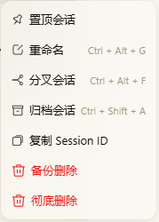
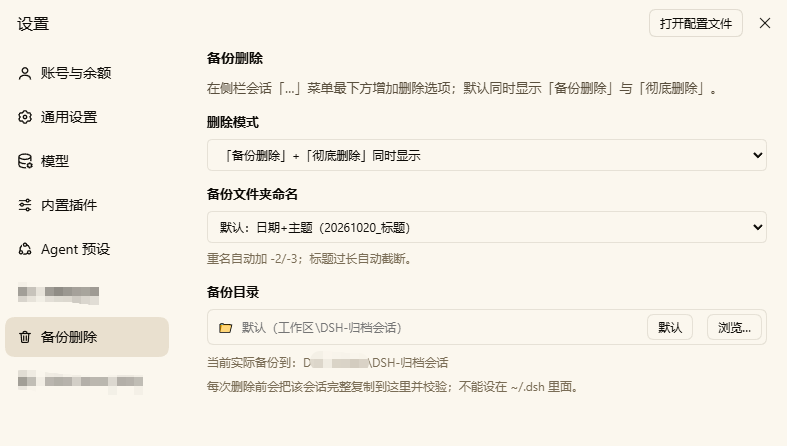

# dsh-session-archive-delete

给 DeepSeek Harness（DSH）的会话列表加一个安全的「删除」入口：**先完整备份到本地，校验通过后才删除**。

装上之后，在侧栏任意会话的「…」菜单最下方会多出删除选项：



## 为什么需要它

DSH 只有「归档」，没有删除。想真正释放磁盘空间就得手动去找
`~/.dsh/sessions/<工作区>/<uuid>/` 删目录，同时还要手动清理
`workspace.json` 和投影缓存——漏一步，侧栏就会留下点不开的空壳会话。

本插件把这件事做成一条安全的流水线：

```
确认 → 复制会话目录 + 缓存 + 元数据快照 → 逐文件校验 → 删除原件 → 清理账本
```

任何一步失败都会中止，原会话保持完好。

## 功能

| 功能 | 说明 |
|---|---|
| 备份删除 | 把会话完整备份到指定文件夹，校验通过后再删 |
| 彻底删除 | 不备份，直接删除 |
| 两种模式并存 | 菜单可同时显示两个选项，也可只显示其一 |
| 子代理会话 | 自动找出该会话派生的所有子代理，一起备份、一起删除 |
| 自定义备份位置 | 系统文件夹对话框选择，或直接输入路径 |
| 四种命名方式 | 日期+主题 / ID前八位+主题 / 纯主题 / 前八位+主题+日期 |
| 路径校验 | 无效路径当场提示，不会写入设置 |
| 一键恢复 | 每个备份文件夹带 `RESTORE.txt`，按说明复制回去即可 |



## 安装

### 方式一：在 DSH 界面里装（推荐）

左侧栏 **插件** → 右上角 **添加插件** → 输入包名安装：

```
@device1999/dsh-session-archive-delete
```

装完重启 DSH。

### 方式二：命令行

```bash
dsh plugin --profile <profile> add @device1999/dsh-session-archive-delete
```

`<profile>` 通常是 `desktop` 或 `web`，可在 `~/.dsh/profiles/` 下看到。

### 方式三：从源码本地开发

```bash
git clone https://github.com/device1999/dsh-session-archive-delete.git
dsh plugin --profile desktop add file:/path/to/dsh-session-archive-delete
```

或在 profile 的 `package.json` 里写 `link:` 依赖，然后在 `node_modules` 里建一个
指向源码目录的 junction（Windows）或 symlink（macOS / Linux）。

## 使用

### 删除一个会话

1. 侧栏会话行点「…」
2. 选「备份删除」或「彻底删除」
3. 确认框里核对会话名、ID 和备份路径
4. 点「确认」

删除成功后侧栏会立即刷新；如果删的是当前会话，会自动跳到下一个。

### 设置

**设置 → 备份删除**：

| 设置项 | 选项 |
|---|---|
| 删除模式 | 两个菜单项同时显示 / 只显示「备份删除」/ 只显示「彻底删除」 |
| 备份位置 | 点击选择文件夹，或直接编辑地址栏；留空 = 默认位置 |
| 备份文件夹命名 | 四种格式任选 |

设置保存在 `~/.dsh/dsh-session-archive-delete.json`。

### 默认备份位置

按以下优先级确定：

1. 设置里填写的路径
2. 环境变量 `DSH_ARCHIVE_ROOT`
3. 插件配置 `workspaceRoot`
4. 自动推断：从会话记录里选出使用最多的工作区目录
5. 都拿不到时：`<用户主目录>/DSH-归档会话`

> 备份位置不能设在 `~/.dsh` 内部，否则 DSH 会把它当成数据目录重新扫描。

## 备份结构

```
<备份位置>/<按命名规则生成的文件夹>/
  sessions/<工作区目录>/<会话id>/    会话原始文件（保留原名）
  projcache/<会话id>.json            界面投影缓存
  meta/workspace.json                删除前的元数据快照
  meta/session_projcache.json
  manifest.json                      清单：完整 id、标题、大小、子代理列表
  RESTORE.txt                        恢复步骤
```

子代理会话也备份在同一个文件夹的 `sessions/` 下，清单里列在 `subagents` 字段。

## 恢复一个会话

详见每个备份文件夹里的 `RESTORE.txt`，大意是：

1. 完全退出 DSH
2. 把 `sessions/<工作区>/<会话id>` 复制回 `~/.dsh/sessions/<工作区>/`
3. 把 `projcache/<会话id>.json` 复制回 `~/.dsh/storages/session_projcache/sessions/`
4. 在 `~/.dsh/storages/workspace.json` 里把会话 id 加回对应工作区的 `sessionIds`
5. 启动 DSH

## 安全性

- **不删未校验的内容**：复制后逐文件比对大小与数量，不一致就中止
- **删前先摘账本**：先把引用从 `workspace.json` 移除并落盘，再删文件，
  避免 DSH 内存状态把引用写回
- **删后复查**：目录删除后检查 3 次，防止文件句柄重建目录
- **路径边界校验**：会话目录必须位于 `~/.dsh/sessions` 下，且目录名与会话 id 完全一致
- **运行中会话**：先取消当前轮次再删除，不会留下半截日志

## 系统要求

- DSH 0.2.x（Web / 桌面客户端）
- Windows / macOS / Linux
- 系统文件夹对话框依赖 PowerShell 7（Windows）。没有 pwsh 时会自动回退到页面内目录浏览

## 已知限制

- 默认备份位置依赖宿主提供的 `sessionQuery` 服务来推断工作区；取不到时回退到用户主目录
- 子代理关系来自会话 header 的 `parentSession` 字段，会话文件是 zstd 压缩，无法纯读盘解析
- 备份是完整复制，大会话会占用相应磁盘空间

## 卸载

```bash
dsh plugin --profile <profile> remove dsh-session-archive-delete
```

重启 DSH。已生成的备份文件夹不会被删除，可按需自行清理。

## License

MIT
